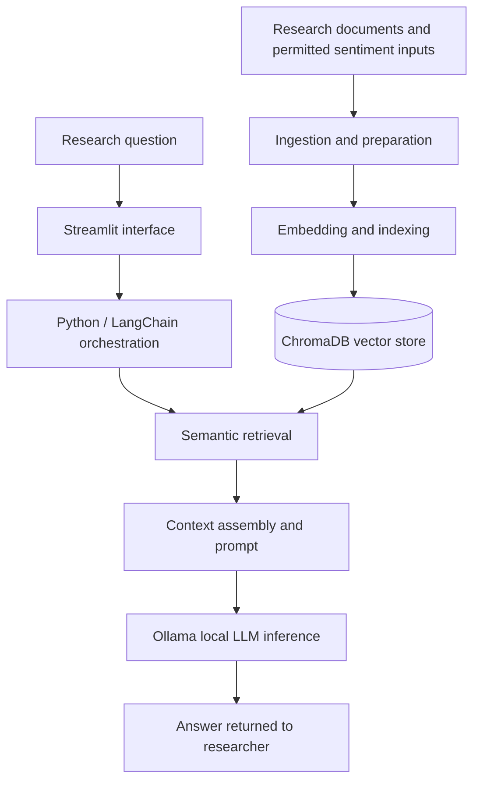

# Privacy-First AI Research Assistant — Technical Case Study

**Carnegie Mellon University × Carnival Corporation | January–May 2025**  
**Role:** Product management and backend / applied-AI development  
**Technologies:** Python, Streamlit, LangChain, Ollama, ChromaDB, Docker, Brandwatch API

> **Portfolio case study only.** This repository contains a high-level, sanitized description of a university client project. It does **not** contain client source code, internal documents, data, credentials, or a working deployment. The architecture below is conceptual, not a reproduction of a confidential system.

## The problem

Research teams need to turn large volumes of market and customer-sentiment information into useful, contextual answers. Keyword search and standalone language-model responses can miss important context or produce unsupported conclusions. Our project explored a retrieval-augmented assistant that could connect user questions with relevant source material while supporting privacy-conscious, local-model workflows.

## What I worked on

- Developed backend and applied-AI components for a Python-based research-assistant prototype.
- Integrated retrieval-augmented generation (RAG) patterns with LangChain, ChromaDB vector retrieval, and Ollama for local LLM inference.
- Worked with Brandwatch-derived sentiment information as an input to research workflows.
- Built a Streamlit interface for conversational research and iteration.
- Iterated on retrieval relevance, prompts, and contextual enrichment to improve answer quality.
- Contributed to product planning and a phased enterprise deployment roadmap.

## Conceptual system architecture

*This is an illustrative architecture showing the principal technologies and data flow; implementation specifics are intentionally omitted.*

## Engineering decisions and trade-offs

### Retrieval instead of relying on model memory
RAG separates finding relevant evidence from generating a readable response. That creates opportunities to diagnose retrieval misses independently from generation errors, although it also introduces indexing, chunking, and context-window trade-offs.

### Local inference for privacy-conscious workflows
Ollama made it possible to experiment with locally hosted models rather than requiring every prompt to be sent to a hosted inference endpoint. Local inference can improve control over data flow, but it requires attention to hardware, throughput, and model quality.

### Treating answer quality as a system property
Answer quality depends on the source material, indexing, retrieval, prompt construction, and model response—not just the language model. We iterated on retrieval and prompt behavior to improve contextual relevance.

## Evaluation and reported outcome

Project work reported an improvement in **contextual answer accuracy from approximately 75% to 91%** through retrieval and prompt-related iteration. This is a project-reported metric, **not** a publicly reproducible benchmark. The original evaluation set, scoring rubric, and client materials are not published here, so the result should be understood in that limited context.

A production-ready evaluation program would also track:

- **Retrieval relevance:** whether retrieved passages contain the needed evidence.
- **Groundedness:** whether an answer is supported by retrieved material.
- **Coverage:** whether important facts are omitted.
- **Failure modes:** empty retrievals, stale documents, contradictory passages, and ambiguous queries.
- **Latency and operational cost:** response times and compute requirements under load.

These are suggested evaluation dimensions, **not a claim that each was measured in the original project**.

## What I learned

The central lesson was that an LLM application is an engineering pipeline. Better answers require inspecting the evidence path, not only rewriting prompts. The project also reinforced the importance of defining measurable user value, building interfaces for iteration, and being clear about the boundary between a prototype and a production system.

## Scope and confidentiality

This write-up is a personal educational portfolio summary. It is **not affiliated with or endorsed by Carnival Corporation**, and it does not include proprietary implementations or materials. There is no source code or live demo in this repository.

**Author:** Neil Sandeep Vibhute  
[LinkedIn](https://www.linkedin.com/in/neilvibhute/)
